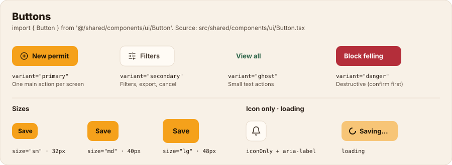
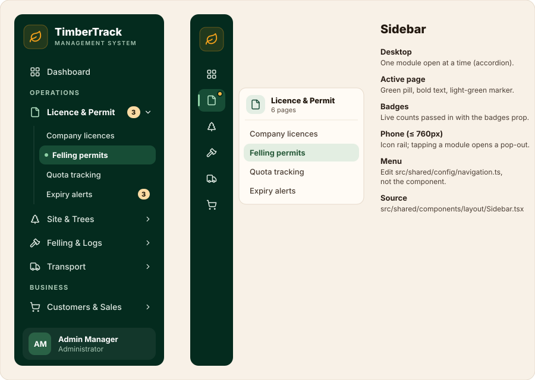

# Design system: how to use it

Everything here follows the **confirmed** design: the Option B palette and navigation, and the Figma file `FZkul22RJVLOX665De4ZNa`. Use these building blocks instead of writing your own colours, buttons or menus.

## 1. Colours, fonts and shapes (tokens)

| File                               | What's in it                                                                         |
| ---------------------------------- | ------------------------------------------------------------------------------------ |
| `src/styles/tokens/colors.css`     | Colours. Use the `--tt-*` names, which match the Figma "Timber Theme" variables.     |
| `src/styles/tokens/typography.css` | Fonts and text sizes (`--font-heading`, `--font-body`, `--font-mono`, `--text-sm` …) |
| `src/styles/tokens/shape.css`      | Corner radius and shadows (`--radius-control`, `--radius-card`, `--shadow-card` …)   |
| `src/styles/fonts.ts`              | Loads the fonts with `next/font`. Already wired into `src/app/layout.tsx`.           |



```css
/* MyTable.module.css */
.header {
  background: var(--tt-surface-header);
  color: var(--tt-text-secondary);
}
.card {
  background: var(--tt-surface-card);
  border: 1px solid var(--tt-border-default);
  border-radius: var(--radius-card);
  box-shadow: var(--shadow-card);
}
.id {
  font-family: var(--font-mono);
} /* PER-010, LOG-001 */
```

Rules:

- Never write a hex value (`#2a6246`) in a component. If a colour is missing, ask an admin to add a token.
- Status colours come in pairs: `--ok-bg` + `--ok-fg`, `--warn-bg` + `--warn-fg`, `--crit-bg` + `--crit-fg`.
- Don't set Sinhala or Tamil fonts yourself. They switch automatically from `<html lang>`.

## 2. Button: `src/shared/components/ui/Button.tsx`

| Variant             | Use for                                                | Looks like        |
| ------------------- | ------------------------------------------------------ | ----------------- |
| `primary` (default) | The **one** main action on a screen                    | Amber             |
| `secondary`         | Filters, export, cancel                                | White with border |
| `ghost`             | Small text actions ("View all")                        | Green text        |
| `danger`            | Destructive or blocking actions (always confirm first) | Red               |

Sizes: `sm` (32px), `md` (40px, default), `lg` (48px, for field screens and big touch targets).



```tsx
import { Button, buttonClassName } from '@/shared/components/ui/Button';
import { Icon } from '@/shared/components/ui/Icon';

<Button leftIcon={<Icon name="plus" />}>New permit</Button>
<Button variant="secondary" leftIcon={<Icon name="sliders" />}>Filters</Button>
<Button variant="ghost" size="sm">View all</Button>
<Button variant="danger">Block felling</Button>
<Button size="lg" fullWidth>Save tree</Button>            {/* field screens */}
<Button loading>Saving…</Button>
<Button iconOnly variant="secondary" aria-label="Notifications"><Icon name="bell" /></Button>

{/* A link that looks like a button */}
<Link href="/licence-permit/felling-permit/new" className={buttonClassName({ variant: 'primary' })}>New permit</Link>
```

## 3. Sidebar: `src/shared/components/layout/Sidebar.tsx`

This is navigation Option B:

- **Desktop:** one module opens at a time, with its pages listed under it.
- **Phone (≤ 760px):** the sidebar becomes an icon rail, and tapping a module shows its pages in a pop-out.



```tsx
import { Sidebar } from '@/shared/components/layout/Sidebar';
import { NAVIGATION } from '@/shared/config/navigation';

<div style={{ display: 'flex', minHeight: '100vh' }}>
  <Sidebar
    groups={NAVIGATION}
    user={{ name: 'Admin Manager', role: 'Administrator', initials: 'AM' }}
    badges={{ 'licence.expiry-alerts': 3, 'site.tree-approval': 9 }} // live counts from the API
    t={t} // i18n function, optional
  />
  <main style={{ flex: 1, minWidth: 0 }}>{children}</main>
</div>;
```

- **Adding or renaming a page in the menu:** edit `src/shared/config/navigation.ts`, not the component.
- Each menu `id` is also its translation key (`nav.<id>.label`) and its badge key.
- The active page is highlighted automatically from the URL.

## 4. Forms, dialogs and page parts

All in `src/shared/components/` and built on the tokens. Text is passed in already translated with `t()`.

| Component                  | Use for                                               | Example                                                                                                                                                                                    |
| -------------------------- | ----------------------------------------------------- | ------------------------------------------------------------------------------------------------------------------------------------------------------------------------------------------ |
| `TextField`                | Text, email, password (`revealable` adds show/hide)   | `<TextField label={t('users.form.email')} type="email" error={errors.email} required />`                                                                                                   |
| `SelectField`              | Drop-downs                                            | `<SelectField label={t('users.col.role')} options={roleOptions} placeholder={t('common.all')} />`                                                                                          |
| `Checkbox`, `RadioGroup`   | Yes/no and one-of-many                                | `<RadioGroup legend={t('users.reset.method')} name="m" options={…} value={v} onChange={setV} />`                                                                                           |
| `Dialog`                   | Popups (wireframe section 18)                         | `<Dialog open={open} onClose={close} title={…} footer={<Button>…</Button>}>…</Dialog>`                                                                                                     |
| `Stepper`                  | Steps in a long popup or form (Information → Review)  | `<Stepper steps={[…]} current={step} label={t('common.progress')} completedLabel={t('common.completed')} onStepClick={setStep} />`                                                         |
| `FormSection`, `FullWidth` | Numbered group of fields ("01 Record information")    | `<FormSection number="01" title={…}><TextField …/><FullWidth><TextField …/></FullWidth></FormSection>`                                                                                     |
| `ConfirmDialog`            | Approve / reject / cancel, with an optional reason    | `<ConfirmDialog open onClose={close} title={…} confirmLabel={t('common.reject')} tone="danger" reason={{ label: t('common.reason'), required: true }} onConfirm={(r) => reject(id, r)} />` |
| `RowMenu`                  | The ••• actions menu on a table row                   | `<RowMenu label={t('common.moreActions', { name: ref })} items={[{ label: t('common.view'), icon: 'eye', onSelect }]} />`                                                                  |
| `Badge`                    | Status pills                                          | `<Badge tone="ok">{t('users.status.ACTIVE')}</Badge>`                                                                                                                                      |
| `Callout`                  | Error / warning / success messages                    | `<Callout tone="crit">{t('auth.errors.ACCOUNT_LOCKED')}</Callout>`                                                                                                                         |
| `Card`                     | Content boxes                                         | `<Card title={t('profile.details')}>…</Card>`                                                                                                                                              |
| `LinkTabs`                 | Tabs that are separate pages                          | `<LinkTabs label="…" tabs={[{ href, label }]} />`                                                                                                                                          |
| `PageHeader`               | Breadcrumb + title + actions at the top of every page | `<PageHeader breadcrumb={[…]} title={t('users.title')} actions={…} />`                                                                                                                     |

Real examples: `src/modules/user-access/fr-01-authentication/` and `fr-02-user-management/`.

**Popups for record actions.** Create, view, edit, approve and reject records in popups on the list
page, so users don't wait for page loads. The FR template (`docs/templates/fr-module/`) does this
already. Use a full page instead for long forms, offline field capture, or records people need to
link to or print. The table "Popup or page?" in `docs/templates/fr-module/README.md` has the details.
Shared words for these actions are in `common.*` (`view`, `edit`, `approve`, `reject`, `reason`, `save`) and
`status.*` (`draft`, `pending`, `approved`, `rejected`).

**Form popups** follow the approved layout: module name above the title (`eyebrow`), a `Stepper` under the
header (`subheader`), numbered `FormSection` cards (`bodyTone="sections"`), and Cancel on the left
(`footerStart`) with Back / Save as draft / Continue on the right. `ExampleFormDialog` in the FR template is
the working example.

## 5. Icons: `src/shared/components/ui/Icon.tsx`

`<Icon name="truck" />`. The icon takes the text colour of its parent. The available names are listed in the file. To add an icon, copy its paths from [lucide.dev](https://lucide.dev).
